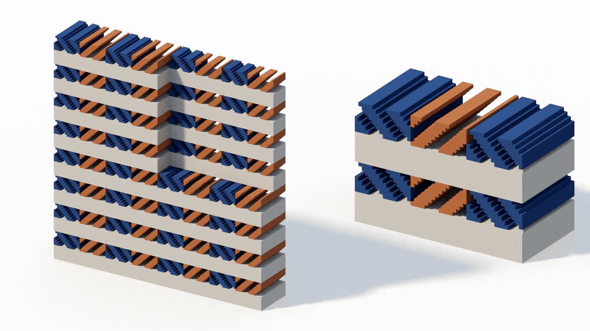
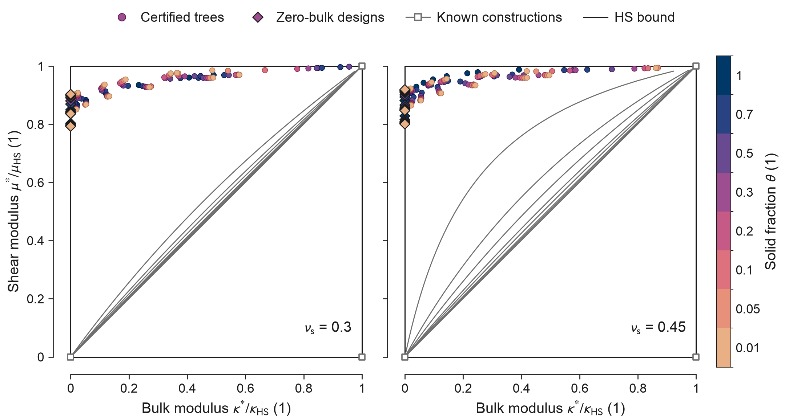
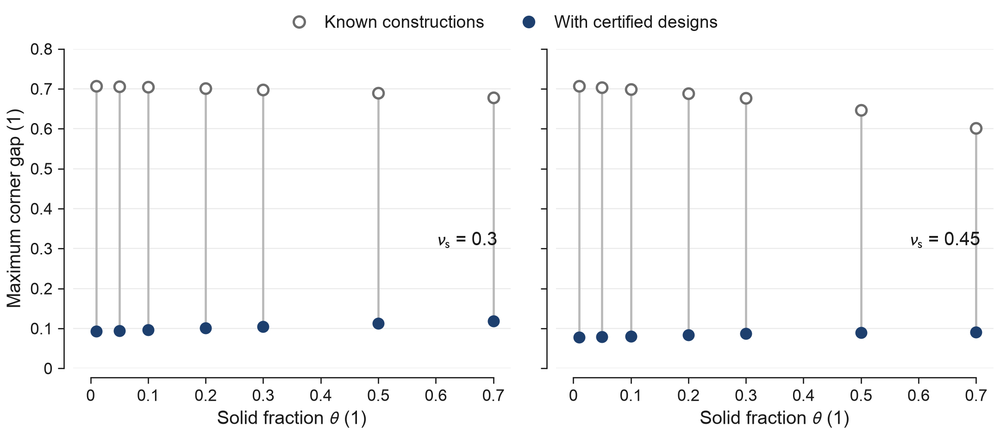
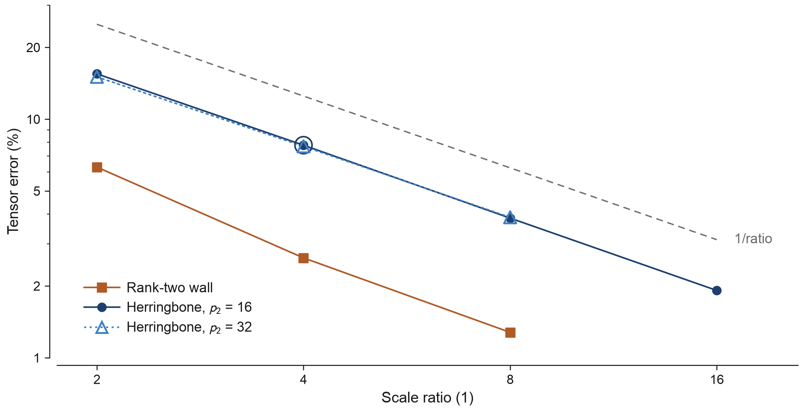

# Zero bulk, strong shear

**These idealised solid-and-void designs retain 87 to 92% of the Hashin-Shtrikman upper bound on shear stiffness at zero bulk modulus.** They can change volume freely while remaining stiff against changes of shape, approaching an open corner of the material stiffness map.

The camera moves around a cutaway of one simulated herringbone wall beside an exact magnified crop. Blue and copper mark opposite plate orientations of the same solid; the geometry stays fixed.

Diamonds mark the zero-bulk designs, near the upper shear bound on the left edge. Each stiffness is divided by its bound for the same solid fraction and base solid.

[Milton's open-problem survey](docs/references.md) asks how closely solid-and-void materials can approach this corner. A literature search on 30 October 2026 found no published construction approaching it in three dimensions at fixed solid fraction; [the search scope and limits](docs/references.md#literature-search) are recorded.

The result covers 14 cases: seven tested solid fractions from 0.01 to 0.7, at base Poisson ratios 0.3 and 0.45. The remaining sampled corner gap is about **0.08 to 0.12**; with the baseline constructions alone it was about **0.6 to 0.7**. [All values and geometries](docs/results.md).

Each pair compares the baseline with the stored designs added, at the same solid fraction. The baseline combines the HS laminate, disconnected solid grains and slip walls.

Quadratic translation bounds cannot tighten this corner for the mixed energy studied here. [The proof](docs/translations.md) shows why void removes the coupling between bulk and shear from this class of bounds.

Each headline structure combines 32 layered pieces, each with its own base geometry and a freely slipping wall. Their motions fit together to let the whole structure dilate without energy; [the construction and proof](docs/zero-bulk.md) explain how.

Doubling the scale ratio roughly halves the error, reaching 1.9% for the herringbone wall at ratio 16. The filled circle and larger ring at ratio 4 show the same geometry at two resolutions; [the finite-scale evidence](docs/finite-scale.md) explains the comparison.

## What this does not show

- Printable cells: the formulas assume infinite separation across eight lamination levels plus the base laminate.
- Exact isotropy: the relative defect is at most 0.001, and zero bulk refers to the compatible geometry before rounding. [Numerical precision](docs/methods.md#precision-and-the-meaning-of-certification).
- Full finite-scale validation: only individual wall steps were simulated, not the complete structures or their extremely thin walls.
- A closed corner or an optimum: the gap is a sampled support comparison, and no stronger outer bound for general microstructures is proved.

## How to use it

Load the [stored geometries](data/certified/README.md), check every headline number with the command in [REPRODUCE.md](REPRODUCE.md), or reuse the [exact laminate algebra](metamaterials/README.md) and [proofs](docs/README.md). The headline check needs only NumPy, SciPy and mpmath; optional commands cover new design searches and direct wall simulations.

Code, data, figures and text are free to use under [CC0 1.0](LICENSE). Dependencies are installed separately under [their own licences](DEPENDENCIES.md).
